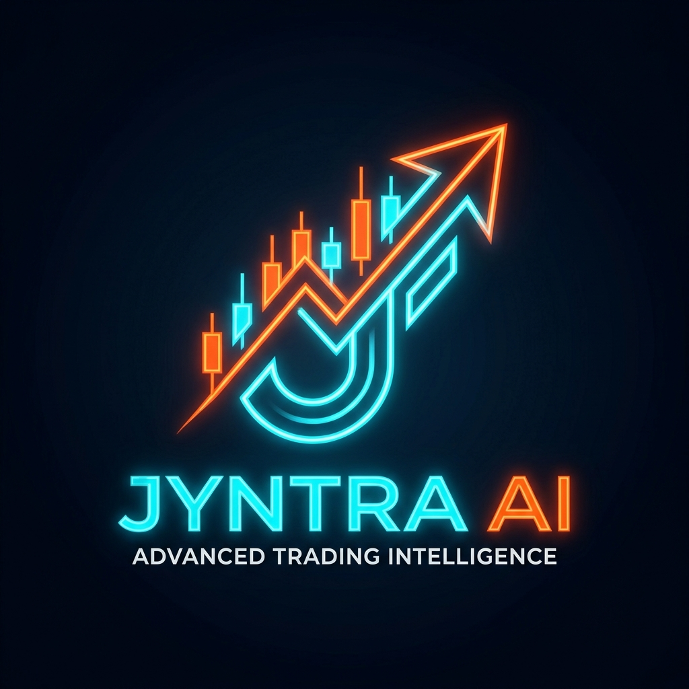
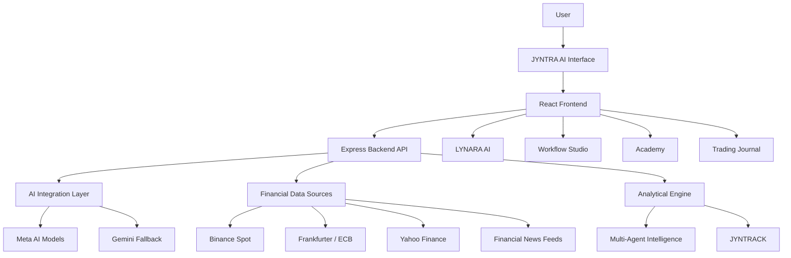
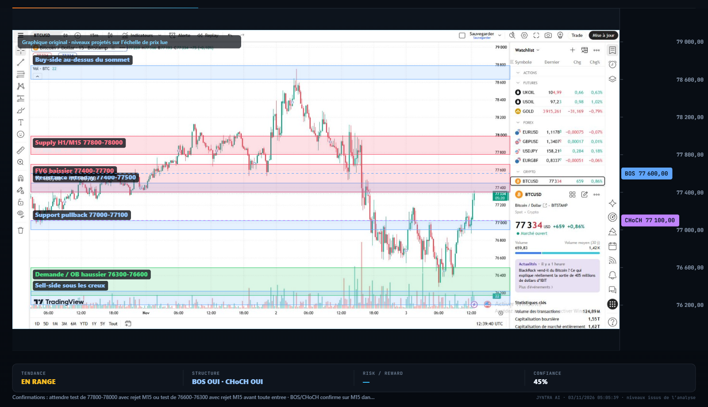
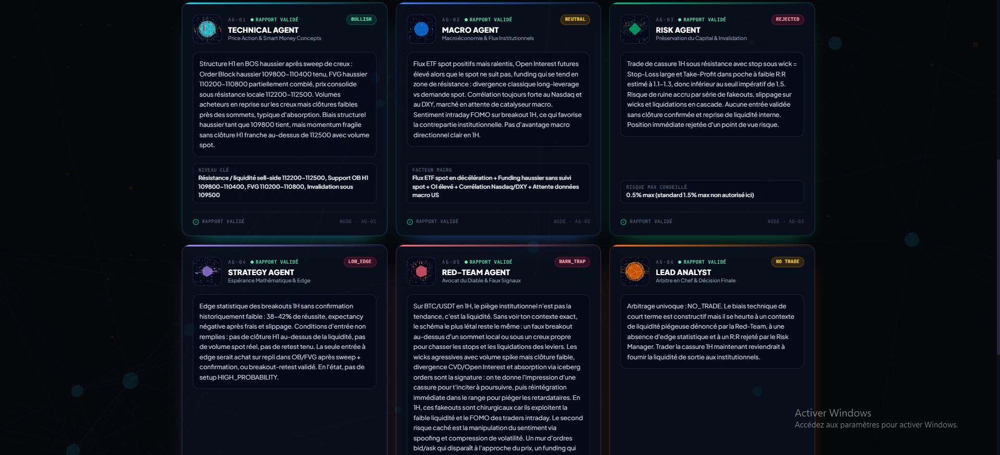
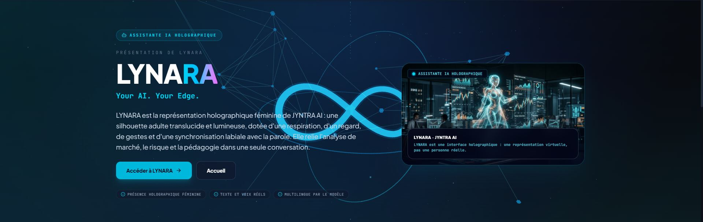
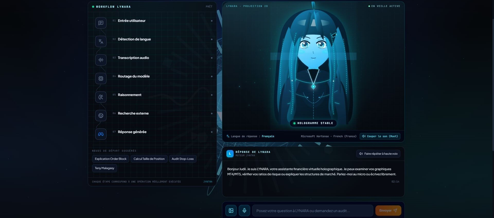

# JYNTRA AI - Your AI. Your Edge.

<p align="center">
  
</p>

<h3 align="center">An AI-powered financial intelligence platform built to transform market complexity into structured insight.</h3>

<p align="center">
  <strong>Observe. Understand. Analyze. Validate.</strong>
</p>

<p align="center">
  <a href="https://jyntra-ai-financial-market-intelligence.onrender.com/">
    
  </a>
  <a href="https://youtu.be/wIKQPydzHrI">
    
  </a>
</p>

<p align="center">
  
  
  
  
</p>

---

## Product Demonstration

<p align="center">
  <a href="https://youtu.be/wIKQPydzHrI">
    
  </a>
</p>

<p align="center">
  <strong>▶ Watch the complete JYNTRA AI demonstration on YouTube</strong>
</p>

<p align="center">
  <a href="https://youtu.be/wIKQPydzHrI">Watch the video</a>
  &nbsp; • &nbsp;
  <a href="https://jyntra-ai-financial-market-intelligence.onrender.com/">Explore the live platform</a>
</p>

---

## Table of Contents

- [Overview](<#-overview>)
- [The Problem](<#-the-problem>)
- [The JYNTRA AI Approach](<#-the-jyntra-ai-approach>)
- [Meta Global AI Hackathon 2026](<#-meta-global-ai-hackathon-2026>)
- [Meta AI Integration](<#-meta-ai-integration>)
- [Platform Features](<#-platform-features>)
- [Multi-Agent Intelligence](<#-multi-agent-intelligence>)
- [JYNTRACK — Quantitative Research](<#-jyntrack--quantitative-research>)
- [Financial Data Infrastructure](<#-financial-data-infrastructure>)
- [Technical Architecture](<#-technical-architecture>)
- [Technology Stack](<#-technology-stack>)
- [Product Showcase](<#-product-showcase>)
- [Getting Started](<#-getting-started>)
- [Environment Configuration](<#-environment-configuration>)
- [Development](<#-development>)
- [Security and Responsible AI](<#-security-and-responsible-ai>)
- [Limitations](<#-limitations>)
- [Future Vision](<#-future-vision>)
- [About the Developer](<#-about-the-developer>)

---

## Overview

**JYNTRA AI - Your AI. Your Edge.** is an AI-powered financial intelligence platform designed to help users explore financial markets through a structured combination of market data, technical analysis, multimodal artificial intelligence, multi-agent reasoning, and quantitative research.

Financial markets generate enormous amounts of information. Understanding that information requires more than identifying patterns on a chart. It involves observing market behavior, interpreting context, evaluating risk, testing hypotheses, and distinguishing evidence from assumptions.

JYNTRA AI brings these activities together in one environment.

Rather than presenting artificial intelligence as an unquestionable source of trading signals, JYNTRA AI aims to make the analytical process more structured, transparent, and research-oriented.

The platform combines a collection of specialized tools and AI-powered capabilities to support financial market exploration.

**Its central philosophy is simple:**

> Intelligence should support better analysis, not replace critical thinking.

**Live platform:**  
https://jyntra-ai-financial-market-intelligence.onrender.com

---

## The Problem

Financial market analysis is often fragmented.

Traders and researchers may need to switch between multiple tools to:

- Examine price movements.
- Interpret technical chart structures.
- Follow macroeconomic developments.
- Understand market news.
- Evaluate trading scenarios.
- Assess risk and reward.
- Record and review their decisions.
- Test historical hypotheses.

This fragmentation makes it difficult to maintain a coherent analytical process.

Artificial intelligence introduces new possibilities, but simply asking a chatbot whether to buy or sell does not provide a sufficiently structured approach to financial research.

A useful system must consider multiple perspectives, distinguish observations from interpretations, evaluate uncertainty, and make its reasoning process easier to examine.

## The JYNTRA AI Approach

JYNTRA AI brings these capabilities into a unified financial intelligence environment.

Its approach combines:

| Analytical dimension | Purpose |
| --- | --- |
| Market Observation | Examine market information and price behavior |
| Technical Interpretation | Identify and organize chart structures |
| AI Reasoning | Explore possible interpretations and hypotheses |
| Multi-Agent Analysis | Evaluate markets through specialized analytical perspectives |
| Risk Assessment | Examine potential exposure and risk/reward relationships |
| Quantitative Research | Investigate historical behavior and test hypotheses |
| Research Tracking | Organize analytical work and monitor observations |

The platform separates three important concepts:

- **Observation:** What can actually be seen in the available data?
- **Interpretation:** What could those observations mean?
- **Hypothesis:** What possible scenario deserves further investigation?

This distinction is fundamental to the philosophy of JYNTRA AI.

---

## Meta Global AI Hackathon 2026

JYNTRA AI was developed for the **Meta Global AI Hackathon 2026**.

<p align="center">
  
</p>

| Information | Details |
| --- | --- |
| Event | Meta Global AI Hackathon 2026 |
| Track | Build for Your World |
| Category | Indie Developer |
| Project | JYNTRA AI |
| Developer | RAMIELSON Geoffroy Judicaël |
| Country | Madagascar 🇲🇬 |

### Why Build for Your World?

Financial market information affects individuals, businesses, and economic decision-making around the world.

JYNTRA AI explores how advanced AI technologies can be applied to a complex real-world domain: financial market intelligence.

The project brings together AI reasoning, multimodal interaction, market information, and quantitative experimentation to create a practical technological experience.

It demonstrates an exploration of how AI can become part of a complete software product rather than remaining an isolated conversational interface.

---

## Meta AI Integration

Meta AI technologies are an important part of the JYNTRA AI experience.

The project explores the use of Meta's AI ecosystem across reasoning, visual understanding, image generation, and voice-related interactions.

Rather than treating AI as a single generic feature, JYNTRA AI organizes AI capabilities around different user needs.

### Meta AI technologies

| Meta technology | Role in the project |
| --- | --- |
| Muse Spark | AI-assisted reasoning and interpretation |
| Muse Wonder | Advanced AI-assisted analytical interactions |
| SAM 3.1 | Visual understanding and segmentation-related capabilities |
| Muse Image | Image-generation capabilities |
| Muse Voice Transcribe | Voice transcription and voice-based interaction |

The exact capabilities available depend on the integration and provider availability.

### From AI models to product capabilities

JYNTRA AI explores several ways to incorporate AI into a financial intelligence workflow:

**1. Reasoning and interpretation**

AI-assisted analysis helps users explore market information, examine possible interpretations, and organize analytical conclusions.

**2. Visual intelligence**

Image-related capabilities support visual workflows involving chart analysis and graphical information.

**3. Multimodal interaction**

The platform explores interactions that go beyond conventional text-based interfaces, including image and voice-related experiences.

**4. Integrated AI assistance**

LYNARA brings AI interaction into the wider platform experience.

### Multi-provider architecture

JYNTRA AI supports a configurable AI integration architecture.

Meta models are integrated into the platform, with alternative providers such as Gemini available as fallback options where configured.

This architecture helps maintain flexibility while keeping provider availability and actual model responses distinct from simulated results.

The platform does not represent a fallback response as a Meta-generated response.

### Meta-only verification mode

JYNTRA AI includes a dedicated **Meta-only mode** that forces the platform to use exclusively Meta AI models, without any fallback to alternative providers. This mode is designed for transparency and verification:

- When enabled, the platform routes all AI reasoning exclusively through Meta models (Muse Spark 1.1/1.2/1.3, Muse Wonder 1.0).
- If Meta models are unavailable, the platform reports an honest failure instead of silently substituting responses from another provider.
- Model selection allows users to choose which Meta model variant to use for each analysis.

#### API verification endpoint

`GET /api/ai/verify` — Diagnostic endpoint that reports the Meta AI integration status without exposing any credentials. It checks:

- Whether `META_API_KEY` is configured server-side.
- Provider catalogue reachability via the Meta endpoint.
- A minimal real Meta chat call (when `metaOnly` routing is used).
- Overall verification status: `verified`, `configured_unverified`, or `not_configured`.

This enables operators to confirm Meta API integration before deploying, without revealing API keys in logs or responses.

#### Execution trace

Every analysis response includes an execution trace showing:

- The provider used (Meta AI, Google Gemini, or alternative).
- The specific model called.
- Latency measurements.
- Execution steps with status and details.

Judges and reviewers can verify that responses genuinely originate from Meta models when Meta-only mode is active.

---

## Platform Features

JYNTRA AI brings several specialized capabilities together in a single environment.

### 1. AI-Powered Chart Analysis

Analyze trading chart images and explore technical market structures.

The platform supports chart-oriented workflows involving:

- MetaTrader 4.
- MetaTrader 5.
- TradingView.

Depending on the available analysis and image-processing capabilities, users can explore:

| Concept | Description |
| --- | --- |
| Order Blocks | Potential areas of institutional order activity |
| Fair Value Gaps | Price inefficiencies and imbalance zones |
| Break of Structure (BOS) | Structural price breaks |
| Change of Character (CHoCH) | Potential changes in market structure |
| Liquidity Zones | Areas associated with potential liquidity concentration |
| Entry Zones | Potential trade-entry areas |
| Stop Loss | Risk-limiting price levels |
| Take Profit | Potential profit-target levels |
| Risk/Reward | Relationship between potential risk and reward |

The goal is to organize technical observations and possible trading scenarios.

AI-generated chart interpretations remain analytical suggestions, not guaranteed market predictions.

### 2. Six-Agent Intelligence

JYNTRA AI incorporates a specialized multi-agent analytical approach.

Each agent has a distinct analytical responsibility.

### 3. LYNARA AI

LYNARA is the intelligent assistant integrated into the JYNTRA AI experience.

It provides an interactive AI interface designed to make financial research and platform interaction more accessible.

Its experience combines conversational interaction with the platform's visual identity and available voice-related capabilities.

### 4. JYNTRACK

JYNTRACK is the quantitative research and probabilistic experimentation environment.

It helps explore historical market behavior, investigate hypotheses, and examine the uncertainty associated with analytical scenarios.

### 5. Workflow Studio

Workflow Studio provides a visual environment for organizing and connecting workflow steps.

It brings workflow-oriented automation concepts into the platform.

### 6. Financial News

The financial news area provides access to relevant market information and news feeds.

It helps users consider broader market context alongside technical observations.

### 7. Academy

The Academy provides an educational environment covering trading concepts, market analysis, planning, and discipline.

### 8. Trading Journal and Risk Management

The platform includes tools for organizing research, recording trading-related information, and examining risk-management considerations.

The objective is to encourage more consistent and documented analytical practices.

---

## Multi-Agent Intelligence

One of the central ideas behind JYNTRA AI is the use of specialized analytical perspectives.

Instead of relying exclusively on a single AI response, the platform incorporates six analytical roles.

| Agent | Primary responsibility |
| --- | --- |
| Technical Analyst | Examines technical structures and price behavior |
| Market Research Analyst | Considers broader market context |
| Risk Analyst | Evaluates potential risk and exposure |
| Strategy Analyst | Examines possible analytical scenarios |
| Red-Team Analyst | Challenges assumptions and identifies weaknesses |
| Lead Analyst | Coordinates the final analytical perspective |

### Why multiple analytical perspectives?

Financial market interpretation is inherently uncertain.

A technical observation may suggest one scenario while macroeconomic information or risk considerations suggest another.

The multi-agent approach is designed to make these differences visible.

The analytical process can therefore consider:

- Technical evidence.
- Market context.
- Risk constraints.
- Strategic coherence.
- Counterarguments.
- Final synthesis.

The platform supports structured outcomes such as BUY, SELL, and WAIT where implemented.

These outputs should be understood as analytical classifications, not instructions to execute trades.

**Risk-aware analysis matters more than producing a confident answer.**

---

## JYNTRACK - Quantitative Research

JYNTRACK is the quantitative experimentation environment within JYNTRA AI.

It explores how historical market information can be used to investigate trading hypotheses.

Instead of treating an interesting market pattern as proof of a profitable strategy, JYNTRACK emphasizes the importance of testing and validation.

Its research-oriented capabilities include applicable techniques such as:

- Bootstrap-based experimentation.
- Historical event studies.
- Probabilistic analysis.
- Backtesting.
- Train/test separation.
- Out-of-sample evaluation.
- Reality Tracker.

### Research philosophy

JYNTRACK is designed around a distinction between:

**Historical observation**

What happened in the available historical data?

**Hypothesis**

What relationship or market behavior are we investigating?

**Experimentation**

How does the hypothesis behave under a defined testing process?

**Validation**

Does the observed behavior remain meaningful outside the data used to formulate the hypothesis?

Historical performance does not guarantee future performance.

The purpose is to encourage evidence-based investigation rather than unsupported certainty.

---

## Financial Data Infrastructure

JYNTRA AI connects to external sources of financial and market information.

Its data infrastructure includes sources such as:

| Source | Information |
| --- | --- |
| Binance Spot | Cryptocurrency market information |
| Frankfurter / ECB | Foreign exchange reference rates |
| Yahoo Finance | Financial market indices |
| Public RSS feeds | Financial news and market information |

These sources provide different categories of information that can contribute to market observation and research.

### Real data, not fabricated market information

JYNTRA AI is designed around the use of actual external market information.

It does not intentionally present fabricated market values as live financial data.

The availability, freshness, and completeness of information depend on the source and its connectivity.

---

## Technical Architecture

JYNTRA AI combines a modern web frontend, a backend API, AI integrations, external data sources, and specialized analytical modules.

### High-level architecture



*Conceptual overview of the platform. It illustrates the main functional areas rather than every internal implementation detail.*

### Frontend

The frontend provides the user-facing experience, platform navigation, analytical interfaces, and interactive visual components.

### Backend

The backend handles application API operations and coordinates access to configured AI providers and external services.

### AI integration

The AI integration layer connects the platform to available AI providers and supports the capabilities exposed through the application.

#### Meta AI Integration Verification

The platform includes a diagnostic endpoint (`/api/ai/verify`) that reports the integration status of Meta AI models without exposing any credentials. It checks:

- Whether `META_API_KEY` is configured server-side
- Provider catalogue reachability via the Meta endpoint
- A minimal real Meta chat call (when `metaOnly` routing is used)
- Fallback configuration (Gemini, free-tier alternative)
- Overall verification status: `verified`, `configured_unverified`, or `not_configured`

This enables operators to confirm Meta API integration before deploying, without revealing API keys in logs or responses.

#### Provider routing

The AI engine uses a Meta-first tier with transparent fallback:

### External data

Market and financial information is obtained from external data providers.

### Analytical environment

Specialized modules organize chart analysis, multi-agent reasoning, risk assessment, and quantitative research.

---

## Technology Stack

JYNTRA AI is built using a modern JavaScript and TypeScript ecosystem.

| Layer | Technologies |
| --- | --- |
| Frontend | React 19 |
| Build Tool | Vite 8 |
| Language | TypeScript |
| Styling | Tailwind CSS 4 |
| Backend | Node.js |
| API Framework | Express 4 |
| 3D Graphics | Three.js |
| AI | Meta AI integrations, Gemini fallback where configured |
| Financial Data | Binance, Frankfurter / ECB, Yahoo Finance |
| Development | npm |

The architecture combines interactive frontend development, backend services, AI integration, and data-driven analytical workflows.

---

## Product Showcase

The following section presents selected visual elements from the JYNTRA AI interface.

### Platform Identity

<p align="center">
  
</p>

### Chart Analysis

<p align="center">
  
</p>

### Multi-Agent Intelligence

<p align="center">
  
</p>

### LYNARA AI

<p align="center">
  
</p>

<p align="center">
  
</p>

---

## Getting Started

You can run JYNTRA AI locally to explore its development environment.

### Prerequisites

Make sure you have:

- Node.js installed.
- npm installed.
- Git installed.
- Access to the required provider credentials for the AI and external services you intend to use.

### 1. Clone the repository

```bash
git clone YOUR_REPOSITORY_URL
cd YOUR_PROJECT_DIRECTORY
```

Replace the placeholders with the actual repository URL and directory name.

### 2. Install dependencies

```bash
npm install
```

### 3. Configure environment variables

Create a local environment configuration based on the project's existing environment example, if available.

Do not commit private credentials or API keys.

Refer to the actual environment configuration and backend implementation to identify the required variables.

### 4. Start the development server

```bash
npm run dev
```

Open the local URL displayed by Vite in your terminal.

---

## Environment Configuration

JYNTRA AI may require provider credentials and configuration values to enable its external integrations.

Depending on the enabled functionality, configuration may include:

- Meta AI provider credentials.
- Gemini credentials, where configured.
- External data provider settings.
- Backend application configuration.

**Important:**

- Never expose API keys in frontend code.
- Never commit `.env` files containing secrets.
- Keep credentials in server-side environment variables.
- Use the actual variable names defined by the project's backend and environment example.
- Do not assume that every provider is mandatory for every application feature.

The application experience may vary depending on which integrations are configured and available.

---

## Development

The project uses npm-based development workflows.

Typical commands include:

```bash
npm run dev
```

To build the application:

```bash
npm run build
```

Where supported by the repository, type checking and automated tests can be executed using their corresponding npm scripts.

Consult `package.json` for the exact scripts available in the current version of the project.

A successful production build does not independently guarantee the availability of external AI providers or financial data services.

---

## Docker Deployment

The project includes containerization support for reproducible deployment.

### Dockerfile

A multi-stage `Dockerfile` is provided at the repository root:

- **Build stage:** Installs dependencies and builds the Vite frontend
- **Runner stage:** Serves the built frontend and Express API as a non-privileged user
- **Health check:** Validates the `/api/health` endpoint

### docker-compose.yml

A `docker-compose.yml` file defines the `jyntra-ai` service with port mapping, environment file support, and health checks.

### Commands

```bash
# Build and run with Docker Compose
docker-compose up --build

# Build image only
docker build -t jyntra-ai .

# Run container directly
docker run -p 3000:3000 --env-file .env jyntra-ai
```

---

## Continuous Integration

GitHub Actions CI is configured at `.github/workflows/ci.yml`. The pipeline runs on every push to `main` and on pull requests targeting `main`:

1. Checkout repository
2. Set up Node.js 20.19.0
3. Install dependencies (`npm ci`)
4. TypeScript typecheck (`npm run typecheck`)
5. Test suite (`npm test`)
6. Benchmarks (`npx tsx benchmarks/run.js`)
7. Production build (`npm run build`)
8. Docker build check

All tests run without requiring production API keys; providers are mocked where necessary.

---

## Benchmarks

Quantitative benchmarks are located in the `benchmarks/` directory. They provide deterministic, reproducible measurements of financial calculations and AI engine routing behavior.

### Benchmark suites

| Suite | File | Coverage |
|-------|------|----------|
| Financial calculations | `benchmarks/financial.js` | Risk calculator, backtest engine |
| AI engine routing | `benchmarks/ai-engine.js` | Fallback chain, model routing, provider transparency |

### Running benchmarks

```bash
npx tsx benchmarks/run.js
```

Results are written to `benchmarks/results/results.json` and `benchmarks/results/results.md`. All benchmarks run without external API dependencies.

---

## Security and Responsible AI

JYNTRA AI is designed as an analytical and research-oriented platform.

Several principles guide its use:

**Credential protection**

Private API credentials should remain on the backend and must not be published in the repository.

**Provider transparency**

AI-generated results should be associated with the actual provider used. A fallback provider must not be misrepresented as Meta.

**Data integrity**

External financial information should not be replaced with invented values presented as real market data.

**Analytical transparency**

Observations, interpretations, and hypotheses should remain distinguishable.

**Human judgment**

AI-generated analyses are decision-support information. Users remain responsible for their own financial decisions.

**No automatic trading**

JYNTRA AI is not presented as an autonomous trading execution system.

---

## Limitations

JYNTRA AI is an evolving software project.

Its capabilities depend on:

- External provider availability.
- API credentials and access permissions.
- Network connectivity.
- Financial data source limitations.
- AI model availability.
- The quality and completeness of the supplied information.

AI-generated interpretations may be incorrect or incomplete.

Historical analyses do not guarantee future outcomes.

The platform should not be considered a financial adviser, investment recommendation service, or guarantee of trading profitability.

---

## Future Vision

JYNTRA AI explores the possibilities of combining advanced AI technologies with financial intelligence.

Its longer-term direction includes continued exploration of:

- More sophisticated multimodal AI experiences.
- Improved analytical collaboration between specialized agents.
- More extensive quantitative experimentation.
- Better research traceability.
- Expanded workflow automation.
- More accessible financial education.
- Stronger analytical validation tools.

These are development directions, not claims that every capability is already available.

---

## About the Developer

<p align="center">
  <strong>RAMIELSON Geoffroy Judicaël</strong>
</p>
<p align="center">
  Full Stack Developer · Master 1 Computer Science Student
</p>
<p align="center">
  ONIFRA · Madagascar 🇲🇬
</p>

I am a Full Stack Developer and Master 1 Computer Science student at ONIFRA, Madagascar.
My interests include software development, artificial intelligence, automation, and emerging technologies.
My ambition is to transform innovative ideas into concrete technological solutions.

**JYNTRA AI** represents this vision: exploring how modern AI technologies can be combined with software engineering to address complex real-world challenges.

### Project Information

| | |
|---|---|
| Project | JYNTRA AI |
| Tagline | Your AI. Your Edge. |
| Developer | RAMIELSON Geoffroy Judicaël |
| Country | Madagascar 🇲🇬 |
| Event | Meta Global AI Hackathon 2026 |
| Track | Build for Your World |
| Category | Indie Developer |

<p align="center">
  <a href="https://jyntra-ai-financial-market-intelligence.onrender.com/">
    <strong>Explore JYNTRA AI</strong>
  </a>
  &nbsp; • &nbsp;
  <a href="https://youtu.be/wIKQPydzHrI">
    <strong>Watch the Demonstration</strong>
  </a>
</p>

<p align="center">
  <strong>JYNTRA AI - Your AI. Your Edge.</strong>
</p>

<p align="center">
  <em>Observe the market. Challenge assumptions. Think beyond signals.</em>
</p>

---

<p align="center">
  Built with innovation, engineering, and AI in Madagascar 🇲🇬
</p>
