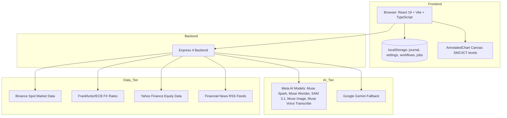

# JYNTRA AI

> Your AI. Your Edge. — Financial Market Intelligence Platform.

[](https://www.typescriptlang.org/)
[](https://react.dev/)
[](https://vitejs.dev/)
[](https://tailwindcss.com/)
[](https://expressjs.com/)
[](https://ai.meta.com/)
[](LICENSE)

**JYNTRA AI** is a financial market intelligence platform that combines real market data, multimodal chart analysis, and a multi-agent AI reasoning layer into a single workspace. Built for traders, analysts, and individuals who want AI assistance to frame and document their market reading — not to predict the market.

*Analyze. Understand. Anticipate.*

---

## Table of Contents

1. [Project Overview](#project-overview)
2. [Problem & Solution](#problem--solution)
3. [Key Features](#key-features)
4. [Technical Architecture](#technical-architecture)
5. [Meta Model Integration](#meta-model-integration)
6. [Multi-Agent Architecture](#multi-agent-architecture)
7. [Tech Stack](#tech-stack)
8. [Financial Data Sources](#financial-data-sources)
9. [Project Structure](#project-structure)
10. [Screenshots & Demo](#screenshots--demo)
11. [Prerequisites & Installation](#prerequisites--installation)
12. [Environment Variables](#environment-variables)
13. [Running Frontend & Backend](#running-frontend--backend)
14. [Build & Tests](#build--tests)
15. [Security & AI Limits](#security--ai-limits)
16. [Meta Hackathon Context](#meta-hackathon-context)
17. [Hackathon Contributions](#hackathon-contributions)
18. [License](#license)

---

## Project Overview

JYNTRA AI is a financial market intelligence platform that combines real-time market data, multimodal chart vision, and a collegiate multi-agent AI layer into a single coherent workspace. It helps traders and analysts read markets more clearly, evaluate scenarios, and make more structured decisions — without promises of gains and without fabricated signals.

Every analysis distinguishes three layers: what is observed (factual visual data), what is interpreted (algorithmic reading), and what remains a hypothesis (conditional scenarios). This separation is the core of the platform's intellectual honesty.

## Problem & Solution

Most analysis tools stack indicators without structure. JYNTRA AI addresses the gap between raw market data and disciplined decision-making by:

- Requiring multiple specialized AI agents to debate before producing a verdict.
- Separating market observations from AI interpretations and hypotheses.
- Keeping analyses, risk management, journaling, and education in one consistent data space.
- Providing real market data from public sources (Binance Spot, ECB/Frankfurter, Yahoo Finance) — zero synthetic quotes.

## Key Features

- **Multimodal chart analysis** — Import MT4, MT5, and TradingView chart screenshots. AI vision detects Market Structure (BOS, CHoCH), Order Blocks, Fair Value Gaps, and liquidity zones.
- **Six specialized agents** — Technical Analyst, Market Research Analyst, Risk Manager, Strategy Analyst, Red-Team Analyst, and Lead Analyst debate dialectically before shaping a trade plan.
- **BUY / SELL / NO TRADE consensus** — Clear collegiate verdict with entry zones, Stop Loss, Take Profit targets, and Risk/Reward ratio.
- **JYNTRACK — Probabilistic laboratory** — Explore market scenarios with empirical block bootstrap, evaluate strategy performance out of sample, and track hypotheses against real outcomes via the Reality Tracker.
- **Advanced risk management** — Mathematical position sizing, strict Stop-Loss validation, mandatory R:R >= 1.5, and risk-of-ruin warnings.
- **Live markets & news** — Real-time spot quotes, order book depth, and financial news aggregated from public RSS feeds.
- **Trading journal** — Record and track positions with screenshots, psychological notes, and results.
- **Workflow Studio** — Visual pipeline execution: Data → Vision AI → Multi-Agents → Risk → Report. Each block performs a real operation; nothing is simulated.
- **LYNARA — Holographic assistant** — Multilingual text and voice interface that explains analyses, reformulates agent reasoning, and guides users through the platform.

## Technical Architecture



Frontend: React 19 + Vite 8 + TypeScript + Tailwind CSS 4, Three.js 3D scenes
Backend: Express 4 (Node.js) exposing REST endpoints
AI layer: Meta-first routing with Gemini fallback when Meta models are unavailable
Persistence: Browser localStorage for journal, settings, workflows, and chart jobs
Async: Background chart analysis jobs with resumable status and owner-scoped tokens

## Meta Model Integration

JYNTRA AI is built Meta-first. Verified integrations:

| Model | Role | Responsibility |
|-------|------|----------------|
| **Muse Spark** | Reasoning & vision | Powers the six multi-agent debate, LYNARA assistant, and chart analysis synthesis |
| **Muse Wonder** | Deep reasoning | Advanced reasoning for complex chart interpretation and scenario planning |
| **SAM 3.1** | Visual detection | Segmentation and box detection for chart image analysis (probed via Meta Responses API) |
| **Muse Image** | Visual generation | Generation of illustrations and graphical elements for the platform |
| **Muse Voice Transcribe** | Audio transcription | Real-time voice message transcription for LYNARA voice interactions |

Each model is called with its declared identifier, sent verbatim to the provider. The provider catalogue decides real availability. When Meta models are unavailable (quota, billing, endpoint down), the backend falls back to Google Gemini while preserving the same response contract. A free-tier alternative (Groq-compatible) is available as a third tier when configured.

## Multi-Agent Architecture

Six specialized agents collaborate per analysis:

1. **Technical Analyst** — Price Action & Smart Money Concepts: Order Blocks, FVG, BOS, CHoCH, support/resistance, volumes.
2. **Market Research Analyst** — Macroeconomics & Institutional Flows: refinancing rates, ETF flows, DXY correlations, economic calendar.
3. **Risk Manager** — Capital Preservation & Invalidation: strict veto on setups with R:R < 1.5 or arbitrary Stop-Loss.
4. **Strategy Analyst** — Mathematical Expectancy & Edge: statistical probability of success under current volatility regime.
5. **Red-Team Analyst** — Devil's Advocate & False Signals: bull traps, false breakouts, manipulative liquidity sweeps.
6. **Lead Analyst** — Chief Arbitrator & Final Decision: weighs contradictory arguments, delivers unified verdict (BUY / SELL / NO TRADE).

The Risk Manager holds veto power. Final output is a structured verdict with entry, Stop Loss, Take Profit, R:R, plus explicit observation vs. interpretation separation.

## Tech Stack

- React 19, Vite 8, TypeScript, Tailwind CSS 4
- Express 4 (Node.js)
- Three.js, Lucide React, Framer Motion
- Meta AI (Muse Spark, Muse Wonder, SAM 3.1, Muse Image, Muse Voice Transcribe)
- Google Gemini (fallback tier)
- Public market data: Binance Spot, Frankfurter/ECB, Yahoo Finance

## Financial Data Sources

All market data is real, sourced from public APIs. No prices are invented.

| Source | Data | Notes |
|--------|------|-------|
| **Binance Spot** | Crypto spot candles, order book depth, ticker search | Real-time spot for cryptocurrencies and PAXG/USDT (gold proxy) |
| **Frankfurter / ECB** | FX reference rates | Daily official rates from the European Central Bank |
| **Yahoo Finance** | Equity index history | S&P 500, Dow Jones, Nasdaq, Euro Stoxx 50, FTSE 100, Nikkei 225 |
| **Public RSS feeds** | Financial news | CNBC, MarketWatch, Nasdaq, Investing.com, BBC Business, CoinDesk, Federal Reserve, ECB, Bank of England |

News articles retain their original title, link, source, publication date, and image. No article is AI-generated.

## Project Structure

```
jyntra-ai/
├── server.ts              # Express entry point with port fallback
├── server/
│   ├── api.ts             # REST endpoints: AI, market data, news, JYNTRACK
│   ├── jobs.ts            # Background job store (chart analysis, async execution)
│   └── jyntrack.ts        # Probabilistic laboratory (bootstrap, backtest, event study, reality check)
├── src/
│   ├── App.tsx            # Application shell with routing
│   ├── components/        # React components (3D, chart, intelligence, layout, lynara, ui, workflow)
│   ├── pages/             # Route pages (Home, Markets, Chart Analysis, Multi-Agents, JYNTRACK, etc.)
│   ├── services/          # Client services (auth, storage, chartJob, workflowBuilder, jyntrackStore)
│   ├── server/            # AI routing engine (aiEngine.ts)
│   ├── i18n/              # Translations (FR, EN, MG) & academy content
│   ├── hooks/             # Custom hooks (LYNARA voice, Jarvis voice)
│   ├── types/             # TypeScript type definitions
│   └── utils/             # Utilities (risk calculator, backtest engine, language detection)
├── tests/                 # Test suites (aiEngine, workflowStore, detectLanguage, jyntrack, translations)
├── public/                # Static assets (logos, images)
├── .env.example           # Environment template
├── package.json
├── tsconfig.json
├── vite.config.ts
└── render.yaml            # Render.com deployment configuration
```

## Screenshots & Demo

Screenshots and demo video references should be placed under `public/assets/` and linked here.

- `public/assets/chart-analysis.jpg` — Chart analysis interface
- `public/assets/chart_ai_multiagent_1793088296716.jpg` — Multi-agent consensus view
- `public/assets/jarvis_holographic_ai_1793088284614.jpg` — LYNARA holographic interface
- `public/assets/jyntra_logo_1793088270760.jpg` — JYNTRA AI logo

Demo video: available upon request.

## Prerequisites & Installation

- Node.js >= 20.19.0
- npm or bun

```bash
git clone https://github.com/<your-org>/jyntra-ai.git
cd jyntra-ai
npm install
```

## Environment Variables

Create a `.env` file at the root from `.env.example` and fill in your API keys. No keys are stored in the frontend or exposed publicly.

```bash
cp .env.example .env
# then edit .env with your values
```

| Variable | Description | Required |
|----------|-------------|----------|
| `META_API_KEY` | Meta AI provider API key (server-side only) | Yes |
| `META_API_ENDPOINT` | Meta API base URL (default: https://api.meta.ai/v1) | No |
| `META_MODELS` | Comma-separated declared Meta model IDs | No |
| `GEMINI_API_KEY` | Google Gemini API key (fallback tier) | No |
| `GROQ_API_KEY` | Groq free-tier API key (third tier) | No |
| `PORT` | Server port (default: 3000) | No |

## Running Frontend & Backend

```bash
# Development (frontend + API mounted in Vite)
npm run dev

# Development (API-only server)
npm run dev:api

# Production (build + start)
npm run build
npm start

# Preview production build locally
npm run preview
```

The platform is available in your browser (default Vite port 5173, or the port shown on server startup).

## Build & Tests

```bash
# Typecheck
npm run typecheck

# Production build
npm run build

# Test suite
npm test
```

Tests cover: AI engine fallback chain, workflow store persistence, language detection, JYNTRACK laboratory, and translation completeness.

## Security & AI Limits

- API keys and secrets are server-side only; `.env` is gitignored and never committed.
- Security headers applied: CSP, HSTS, X-Frame-Options, X-Content-Type-Options, Referrer-Policy, Permissions-Policy, Cross-Origin-Opener-Policy.
- CORS enabled with explicit method and header allowlisting.
- Input validation on all endpoints; no SQL/NoSQL injection surface (storage is local browser localStorage).
- Rate limiting on AI and heavy endpoints to protect against abuse.
- AI outputs are assistive, not financial advice. Analyses, signals, and scenarios are not personalized financial recommendations.
- JYNTRACK scenarios are conditional distributions, not forecasts. No transaction is triggered automatically.

## Meta Hackathon Context

Project submitted to the **Meta Global AI Developer Hackathon 2026**, **Indie Developer** track, **Build for Your World** orientation. JYNTRA AI demonstrates how Meta's AI technologies can power a concrete, accessible financial decision-support tool.

## Hackathon Contributions

Features and improvements developed during the hackathon:

- Meta-first model routing with Gemini fallback and free-tier alternative
- Multimodal chart analysis with SAM 3.1 visual detection probing
- Multi-agent debate with Risk Manager veto power
- LYNARA holographic assistant with voice transcription (Muse Voice Transcribe)
- JYNTRACK probabilistic laboratory with Reality Tracker
- Workflow Studio with real block execution and resume capability
- Interactive trading academy with quizzes (8 modules, 3 languages)
- Dark/light theme support and responsive layouts
- CORS, rate limiting, and security headers
- Proper HTTP error status codes and honest AI unavailability handling

Features pre-existing before the hackathon remain fully preserved and operational.

## Visual Identity

JYNTRA AI uses a Meta-inspired visual system: deep Meta blue (`#003263`), JYNTRA black (`#080B10` dark mode, `#F8FAFC` light mode), and JYNTRA orange accent (`#F97316`). The interface supports both dark and light themes with responsive layouts across desktop, tablet, and Android devices.

## License

No license specified. All rights reserved by the author.

---