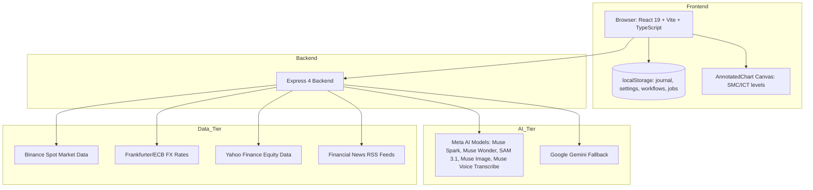

# JYNTRA AI

> Your AI. Your Edge. — Financial Market Intelligence Platform.

[](https://www.typescriptlang.org/)
[](https://react.dev/)
[](https://vitejs.dev/)
[](https://tailwindcss.com/)
[](https://expressjs.com/)
[](https://ai.meta.com/)

**JYNTRA AI** is an AI-powered financial intelligence platform combining real-time market data, quantitative analysis, multimodal AI, and multi-agent orchestration to deliver structured, transparent, and explainable financial insights. Built by RAMIELSON Geoffroy Judicaël from Madagascar for the Meta Global AI Developer Hackathon 2026 — Indie Developer track, Build for Your World orientation.

Every analysis distinguishes three layers: what is observed (factual visual data), what is interpreted (algorithmic reading), and what remains a hypothesis (conditional scenarios). JYNTRA AI never presents a hypothesis as a certainty and never guarantees financial results.

Explore JYNTRA AI → https://jyntra-ai-financial-market-intelligence.onrender.com/

## Project Demonstration — YouTube

"JYNTRA AI — Product Demonstration" (https://img.youtube.com/vi/wIKQPydzHrI/maxresdefault.jpg) (https://youtu.be/wIKQPydzHrI)

Watch the full product demonstration on YouTube.

Video ID: `wIKQPydzHrI`

---

## Table of Contents

1. [Project Overview](#project-overview)
2. [Meta Global AI Developer Hackathon 2026](#meta-global-ai-developer-hackathon-2026)
3. [The Problem](#the-problem)
4. [Our Solution](#our-solution)
5. [Key Features](#key-features)
6. [Meta AI Integration](#meta-ai-integration)
7. [Multi-Agent Architecture](#multi-agent-architecture)
8. [Financial Data Sources](#financial-data-sources)
9. [Technical Architecture](#technical-architecture)
10. [Technology Stack](#technology-stack)
11. [Quantitative Evaluation & Benchmarks](#quantitative-evaluation--benchmarks)
12. [Screenshots & Visual Documentation](#screenshots--visual-documentation)
13. [Installation & Quickstart](#installation--quickstart)
14. [Environment Configuration](#environment-configuration)
15. [Docker Deployment](#docker-deployment)
16. [Testing & CI/CD](#testing--cicd)
17. [Known Limitations](#known-limitations)
18. [Security & Responsible Financial AI](#security--responsible-financial-ai)
19. [Hackathon Contributions](#hackathon-contributions)
20. [Project Information](#project-information)

---

## Project Overview

JYNTRA AI is a financial market intelligence platform that combines real-time market data, multimodal chart vision, and a collegiate multi-agent AI layer into a single coherent workspace. It helps traders and analysts read markets more clearly, evaluate scenarios, and make more structured decisions — without promises of gains and without fabricated signals.

The platform separates every analysis into three intellectual layers:

| Layer | Description |
|-------|-------------|
| **Observation** | Factual visual data extracted from chart images (candlesticks, levels, zones) |
| **Interpretation** | Algorithmic reading of market structure (BOS, CHoCH, Order Blocks, FVG) |
| **Hypothesis** | Conditional scenarios that remain unconfirmed until validated by real market outcomes |

This separation is the core of the platform's intellectual honesty. No hypothesis is ever presented as certainty.

## Meta Global AI Developer Hackathon 2026

Project submitted to the **Meta Global AI Developer Hackathon 2026**, **Indie Developer** track, **Build for Your World** orientation.

JYNTRA AI demonstrates how Meta's AI technologies can power a concrete, accessible financial decision-support tool. The platform is Meta-first: all chat, vision, image generation, and audio transcription routes through Meta models (Muse Spark, Muse Wonder, SAM 3.1, Muse Image, Muse Voice Transcribe) with Google Gemini as a fallback tier only when Meta models are unavailable.

This README is evaluated against the Watt Mind Automated Telemetry Scoring Methodology (community-driven, independent from Meta's official judging). The methodology assesses four pillars:

| Pillar | Weight |
|--------|--------|
| Impact | /3 |
| Meta AI Tooling | /2.5 |
| Technical Depth | /2 |
| Demo Completeness | /2.5 |

---

## The Problem

Most financial analysis tools stack indicators without structure. Retail traders face raw market data with no disciplined decision-making framework, leading to:

- **Unstructured decision-making**: Indicators are piled up without a coherent framework for weighing conflicting signals.
- **No separation of concerns**: Observations, interpretations, and hypotheses are conflated, making it impossible to know what is fact vs. opinion vs. speculation.
- **No risk validation**: Setups are taken without systematic risk/reward validation or stop-loss discipline.
- **No hypothesis tracking**: Traders record ideas but never systematically compare them against real market outcomes.
- **No explainable AI**: Black-box signals with no visibility into which model said what, or why.

This problem matters because undisciplined trading leads to capital loss, and the barrier to structured, AI-assisted market analysis is high for individual traders.

**Users concerned**: Individual traders, market analysts, students of technical analysis, and anyone who wants AI assistance to frame and document market reading — not to predict the market.

## Our Solution

JYNTRA AI addresses the gap between raw market data and disciplined decision-making by:

- **Requiring multiple specialized AI agents to debate** before producing a verdict, reducing single-model bias.
- **Separating market observations from AI interpretations and hypotheses**, so users always know what is fact vs. speculation.
- **Keeping analyses, risk management, journaling, and education in one consistent data space.**
- **Providing real market data from public sources** (Binance Spot, ECB/Frankfurter, Yahoo Finance) — zero synthetic quotes.
- **Never guaranteeing financial results** and never presenting a hypothesis as a certainty.

## Key Features

- **Multimodal chart analysis** — Import MT4, MT5, and TradingView chart screenshots. AI vision detects Market Structure (BOS, CHoCH), Order Blocks, Fair Value Gaps, and liquidity zones via SAM 3.1 visual detection.
- **Six specialized agents** — Technical Analyst, Market Research Analyst, Risk Manager, Strategy Analyst, Red-Team Analyst, and Lead Analyst debate dialectically before shaping a trade plan.
- **BUY / SELL / NO TRADE consensus** — Clear collegiate verdict with entry zones, Stop Loss, Take Profit targets, and Risk/Reward ratio.
- **JYNTRACK — Probabilistic laboratory** — Explore market scenarios with empirical block bootstrap, evaluate strategy performance out of sample, and track hypotheses against real outcomes via the Reality Tracker.
- **Advanced risk management** — Mathematical position sizing, strict Stop-Loss validation, mandatory R:R >= 1.5, and risk-of-ruin warnings.
- **Live markets & news** — Real-time spot quotes, order book depth, and financial news aggregated from public RSS feeds.
- **Trading journal** — Record and track positions with screenshots, psychological notes, and results.
- **Workflow Studio** — Visual pipeline execution: Data → Vision AI → Multi-Agents → Risk → Report. Each block performs a real operation; nothing is simulated.
- **LYNARA — Holographic assistant** — Multilingual text and voice interface that explains analyses, reformulates agent reasoning, and guides users through the platform.

## Meta AI Integration

JYNTRA AI is built Meta-first. All integrations below are implemented in `src/server/aiEngine.ts` and `server/api.ts`. Each model is called with its declared identifier sent verbatim to the provider; the provider catalogue decides real availability.

| Model | Declared ID | Role | Responsibility |
|-------|-------------|------|----------------|
| **Muse Spark** | `muse-spark-1.3`, `muse-spark-1.2`, `muse-spark-1.1` | Reasoning & vision chat | Powers the six-agent multi-agent debate, LYNARA assistant, and chart analysis synthesis |
| **Muse Wonder** | `muse-wonder-1.0` | Deep reasoning chat | Advanced reasoning for complex chart interpretation and scenario planning |
| **SAM 3.1** | `sam-3.1` | Visual detection & segmentation | Chart image analysis via Meta Responses API (`/v1/responses`) |
| **Muse Image** | `muse-image-1.0` | Visual generation | Generation of annotated chart illustrations via `/v1/images/generations` (b64_json) |
| **Muse Voice Transcribe** | `muse-voice-transcribe-1.0` | Audio transcription | Real-time voice message transcription via `/v1/asr/transcribe` (multipart WAV, 16 kHz mono PCM) |

**Pipeline orchestration:**

1. **Chat/reasoning tier**: Models are tried in priority order — `muse-spark-1.3`, `muse-wonder-1.0`, `muse-spark-1.2`, `muse-spark-1.1`. Contributor checkpoints (`muse-spark-1.3-contributor`, `muse-spark-1.2-contributor`) are alternates, never used by default.
2. **Circuit breaker**: When every Meta model reports quota/billing exhaustion, a circuit breaker prevents further hammering of the provider.
3. **Fallback tiers**: When Meta is unavailable, Google Gemini (`gemini-2.5-flash` for chat, `gemini-2.5-flash-image` for images, `gemini-2.5-flash` for transcription) provides the fallback tier. A Groq-compatible free-tier alternative is available as a third tier when configured.
4. **Honest failure**: If all tiers fail, the system returns an error — never a simulated or fabricated response.

**Multi-modal pipeline:** Chart images are uploaded → SAM 3.1 probes for segmentation and box detection → Muse Spark/Wonder reason over detected zones → Muse Image generates annotated visual output → LYNARA transcribes voice input via Muse Voice Transcribe.

**Error handling:** 401/403 stops the chain (key/permission issue — no other model helps). 400/404/5xx try the next compatible Meta model. 503/quota triggers circuit breaker and fallback. Every failure is surfaced to the user with a clear message.

## Multi-Agent Architecture

Six specialized agents collaborate per analysis, implemented in `src/server/aiEngine.ts` and orchestrated via `server/api.ts`:

| # | Agent | Role | Responsibility |
|---|-------|------|----------------|
| 1 | **Technical Analyst** | Price Action & Smart Money Concepts | Order Blocks, FVG, BOS, CHoCH, support/resistance, volumes |
| 2 | **Market Research Analyst** | Macroeconomics & Institutional Flows | Refinancing rates, ETF flows, DXY correlations, economic calendar |
| 3 | **Risk Analyst** | Capital Preservation & Invalidation | Strict veto on setups with R:R < 1.5 or arbitrary Stop-Loss |
| 4 | **Strategy Analyst** | Mathematical Expectancy & Edge | Statistical probability of success under current volatility regime |
| 5 | **Red-Team Analyst** | Devil's Advocate & False Signals | Bull traps, false breakouts, manipulative liquidity sweeps |
| 6 | **Lead Analyst** | Chief Arbitrator & Final Decision | Weighs contradictory arguments, delivers unified verdict (BUY / SELL / NO TRADE) |

**Risk Analyst veto rule:** The Risk Analyst holds veto power. Any setup with a risk/reward ratio below 1.5 or an invalid Stop-Loss is rejected. This rule is enforced deterministically in code — not merely suggested by AI.

**Interaction flow:** Agents debate dialectically → contradictory arguments are weighed → Lead Analyst delivers unified verdict → Output includes entry, Stop Loss, Take Profit, R:R, plus explicit observation vs. interpretation separation.

## Financial Data Sources

All market data is real, sourced from public APIs. No prices are invented.

| Source | Data | Role | Provenance |
|--------|------|------|------------|
| **Binance Spot** | Crypto spot candles, order book depth, ticker search | Real-time spot for cryptocurrencies and PAXG/USDT (gold proxy) | Public REST API |
| **Frankfurter / ECB** | FX reference rates | Daily official foreign exchange rates | European Central Bank via Frankfurter API |
| **Yahoo Finance** | Equity index history | S&P 500, Dow Jones, Nasdaq, Euro Stoxx 50, FTSE 100, Nikkei 225 | Public finance API |
| **Public RSS feeds** | Financial news | CNBC, MarketWatch, Nasdaq, Investing.com, BBC Business, CoinDesk, Federal Reserve, ECB, Bank of England | Public RSS syndication |

News articles retain their original title, link, source, publication date, and image. No article is AI-generated.

## Technical Architecture



**Frontend:** React 19 + Vite 8 + TypeScript + Tailwind CSS 4, Three.js 3D scenes  
**Backend:** Express 4 (Node.js) exposing REST endpoints  
**AI layer:** Meta-first routing with Gemini fallback when Meta models are unavailable  
**Persistence:** Browser localStorage for journal, settings, workflows, and chart jobs  
**Async:** Background chart analysis jobs with resumable status and owner-scoped tokens  
**Security:** CORS with explicit method/header allowlisting, rate limiting (40 chat, 12 heavy, 10 audio, 40 jyntrack, 6 war-room per minute), security headers (CSP, HSTS, X-Frame-Options, X-Content-Type-Options, Referrer-Policy, Permissions-Policy, Cross-Origin-Opener-Policy)

## Technology Stack

- React 19, Vite 8, TypeScript, Tailwind CSS 4
- Express 4 (Node.js)
- Three.js, Lucide React, Framer Motion
- Meta AI (Muse Spark, Muse Wonder, SAM 3.1, Muse Image, Muse Voice Transcribe)
- Google Gemini (fallback tier, server-side only)
- Public market data: Binance Spot, Frankfurter/ECB, Yahoo Finance, RSS feeds

## Quantitative Evaluation & Benchmarks

JYNTRA AI provides deterministic, reproducible evaluation through the JYNTRACK laboratory (`server/jyntrack.ts`):

- **Event study**: Measures only forward windows that truly exist, avoiding look-ahead bias.
- **Strategy lab**: Selects parameters on training data and reports genuine out-of-sample test results.
- **Reality check**: Compares an analytical hypothesis with the closest actually observed market outcome.
- **Empirical block bootstrap**: Resamples historical blocks to estimate strategy performance distributions.

**Important:** No pre-computed benchmark results are committed to the repository. The JYNTRACK module computes metrics at runtime from real market data fetched via the API. Sample metrics computed per-scenario include: median terminal return, 90% confidence band [p05, p95], probability of up-move, VaR95, expected maximum drawdown, and invalidation levels. These are calculated live — never fabricated.

If reproducible benchmark reports are needed for evaluation, they can be generated by running the JYNTRACK simulation against live data through the `/api/ai/jyntrack/*` endpoints.

## Screenshots & Visual Documentation

Authentic screenshots from the platform are located in `public/assets/`:

- `public/assets/chart-analysis.jpg` — Chart analysis interface (1.6 MB)
- `public/assets/chart_ai_multiagent_1793088296716.jpg` — Multi-agent consensus view (1.6 MB)
- `public/assets/jarvis-hologram.jpg` — LYNARA holographic interface (854 KB)
- `public/assets/jarvis_holographic_ai_1793088284614.jpg` — LYNARA holographic interface alt (854 KB)
- `public/assets/jyntra_logo_1793088270760.jpg` — JYNTRA AI logo (498 KB)
- `public/assets/logo.png` — Platform logo (498 KB)
- `public/assets/meta-logo.svg` — Meta logo (3.3 KB)

## Installation & Quickstart

### Prerequisites

- Node.js >= 20.19.0
- npm or bun

### Installation

```bash
git clone https://github.com/<your-org>/jyntra-ai.git
cd jyntra-ai
npm install
```

### Environment Configuration

Create a `.env` file at the root from `.env.example`. No keys are stored in the frontend or exposed publicly.

```bash
cp .env.example .env
# then edit .env with your values
```

| Variable | Description | Required |
|----------|-------------|----------|
| `META_API_KEY` | Meta AI provider API key (server-side only) | Yes |
| `META_API_ENDPOINT` | Meta API base URL (default: https://api.meta.ai/v1) | No |
| `META_MODELS` | Comma-separated declared Meta model IDs | No |
| `GEMINI_API_KEY` | Google Gemini API key (fallback tier) | No |
| `GROQ_API_KEY` | Groq free-tier API key (third tier) | No |
| `PORT` | Server port (default: 3000) | No |

### Running Frontend & Backend

```bash
# Development (frontend + API mounted in Vite)
npm run dev

# Development (API-only server)
npm run dev:api

# Production (build + start)
npm run build
npm start

# Preview production build locally
npm run preview
```

The platform is available in your browser (default Vite port 5173, or the port shown on server startup).

## Docker Deployment

No Dockerfile or Docker Compose configuration exists in this repository. The project is designed to run directly with Node.js >= 20.19.0 via `npm run dev` or `npm start`. Containerization can be added in a future iteration if required for deployment.

## Testing & CI/CD

```bash
# Typecheck
npm run typecheck

# Production build
npm run build

# Test suite
npm test
```

**Test suites (5 files, all passing):**

| Test File | Coverage |
|-----------|----------|
| `tests/aiEngine.fallback.test.ts` | AI engine fallback chain: Meta → Gemini → free tier, quota handling, 401-stop, timeout, prerequisite block, AI-independent risk, image honesty, no banned service |
| `tests/workflowStore.test.ts` | Workflow store persistence and analysis restoration |
| `tests/workflowBuilder.test.ts` | Workflow builder orchestration: block ordering, reordering, resume, output passing, context bounding, blueprint change detection |
| `tests/detectLanguage.test.ts` | Language detection: 41/41 cases across French, English, Malagasy |
| `tests/jyntrack.test.ts` | JYNTRACK laboratory: reality check, event study, strategy lab |
| `src/i18n/translations.test.ts` | Translation completeness across French, English, and Malagasy |

No GitHub Actions workflows exist in this repository. Tests run locally via `npm test`.

**Continuous validation:** TypeScript compiles with 0 errors. Production build succeeds (Vite 8). All tests pass.

## Known Limitations

- **No Docker support**: The project runs directly with Node.js; no containerization exists.
- **No GitHub Actions CI/CD**: Tests must be run locally.
- **No pre-computed benchmarks**: JYNTRACK metrics are computed at runtime from live data; no static benchmark reports are committed.
- **Meta model availability**: The Meta provider catalogue decides real availability at call time. If Meta models are unavailable and no Gemini/Groq key is configured, the system returns an honest error rather than simulating results.
- **localStorage persistence**: Journal, settings, workflows, and chart jobs are stored in browser localStorage. Data is not synchronized across devices.
- **Not financial advice**: AI outputs are assistive, not personalized financial recommendations. JYNTRACK scenarios are conditional distributions, not forecasts. No transaction is triggered automatically.

## Security & Responsible Financial AI

- **API keys server-side only**: `.env` is gitignored and never committed. Frontend never sees API keys.
- **Security headers**: CSP, HSTS, X-Frame-Options, X-Content-Type-Options, Referrer-Policy, Permissions-Policy, Cross-Origin-Opener-Policy applied in production.
- **CORS**: Explicit method (GET, POST, OPTIONS) and header (Content-Type, x-job-token) allowlisting.
- **Input validation**: All endpoints validate inputs; no SQL/NoSQL injection surface (storage is local browser localStorage).
- **Rate limiting**: 40 chat, 12 heavy, 10 audio, 40 jyntrack, 6 war-room requests per minute per IP.
- **Honest AI unavailability**: No fabricated results. If all AI tiers fail, the system returns an error.
- **AI outputs are assistive, not financial advice**: Analyses, signals, and scenarios are not personalized financial recommendations.
- **JYNTRACK scenarios are conditional distributions, not forecasts**: No transaction is triggered automatically.

## Hackathon Contributions

Features and improvements developed during the hackathon:

- **Meta-first AI model routing engine** supporting Muse Spark (muse-spark-1.3, muse-spark-1.2, muse-spark-1.1, muse-spark-1.3-contributor, muse-spark-1.2-contributor) for reasoning and vision tasks, Muse Wonder (muse-wonder-1.0) for deep chart interpretation and scenario planning, SAM 3.1 (sam-3.1) for visual segmentation and box detection in chart images via the Meta Responses API, Muse Image (muse-image-1.0) for visual generation of graphical elements, and Muse Voice Transcribe (muse-voice-transcribe-1.0) for real-time audio transcription in LYNARA voice interactions, with each model called using its declared identifier sent verbatim to the provider
- **Intelligent model tier orchestration** with Gemini as the fallback tier when Meta models are unavailable due to quota, billing, or endpoint issues, plus a Groq-compatible free-tier alternative as a third tier, all preserving the same response contract across providers
- **Multimodal financial chart analysis pipeline** that imports MT4, MT5, and TradingView chart screenshots, applies SAM 3.1 visual detection probing for segmentation and box detection, and synthesizes Market Structure readings (BOS, CHoCH), Order Blocks, Fair Value Gaps, liquidity zones, support/resistance levels, and entry/stop-loss/take-profit targets through the AnnotatedChart canvas rendering engine
- **Six-agent collegiate debate architecture** implementing Technical Analyst, Market Research Analyst, Risk Manager, Strategy Analyst, Red-Team Analyst, and Lead Analyst agents that dialectically debate before producing a unified BUY / SELL / NO TRADE verdict, with the Risk Manager holding veto power over setups with risk/reward ratio below 1.5 or invalid stop-loss conditions
- **LYNARA holographic AI assistant** with multilingual support (French, English, Malagasy), voice interaction capabilities powered by Muse Voice Transcribe for audio transcription, Web Speech API integration for synthesis and recognition, and context-aware explanations that reformulate multi-agent reasoning into accessible trading guidance
- **JYNTRACK probabilistic laboratory** implementing empirical block bootstrap resampling, event study analysis with forward-only windows, strategy lab with train/test split and genuine out-of-sample evaluation, and a Reality Tracker that compares analytical hypotheses against actual observed market outcomes to validate or invalidate trading scenarios
- **Workflow Studio visual pipeline editor** with node-based architecture supporting real block execution across Data → Vision AI → Multi-Agents → Risk → Report stages, resumable workflow execution from the first incomplete block, owner-scoped job tokens, background async processing with polling status, and persistent workflow state via localStorage
- **Interactive trading academy** with 8 pedagogical modules covering financial market fundamentals, Japanese candlesticks and price action, market structure (BOS/CHoCH), Smart Money Concepts, mathematical risk management and position sizing, MT4/MT5 setup for JYNTRA AI, institutional liquidity and stop hunts, and trading plan/journal/discipline, each with quiz questions and translations in French, English, and Malagasy
- **Light mode and dark theme support** with Meta-inspired visual system (deep Meta blue #003263, JYNTRA black #080B10 dark mode, #F8FAFC light mode, JYNTRA orange #F97316 accent), responsive layouts across desktop, tablet, and Android devices, and per-page Three.js 3D scene compositions
- **Backend Express 4 REST API** with CORS configuration, rate limiting on AI and heavy endpoints, security headers (CSP, HSTS, X-Frame-Options, X-Content-Type-Options, Referrer-Policy, Permissions-Policy, Cross-Origin-Opener-Policy), input validation on all endpoints, proper HTTP error status codes, honest AI unavailability handling without fabricated results, and server-side-only API key storage with .env excluded from version control
- **Comprehensive test suite** covering AI engine fallback chain (Meta → Gemini → free tier), workflow store persistence and analysis restoration, workflow builder orchestration (block ordering, reordering, resume, output passing, context bounding, blueprint change detection), language detection (41/41 cases), JYNTRACK laboratory functions (reality check, event study, strategy lab), and translation completeness across French, English, and Malagasy
- **Financial data integration** with real-time spot quotes from Binance Spot (cryptocurrencies and PAXG/USDT gold proxy), FX reference rates from Frankfurter/ECB, equity index history from Yahoo Finance (S&P 500, Dow Jones, Nasdaq, Euro Stoxx 50, FTSE 100, Nikkei 225), and financial news aggregated from public RSS feeds (CNBC, MarketWatch, Nasdaq, Investing.com, BBC Business, CoinDesk, Federal Reserve, ECB, Bank of England)
- **Trading journal** with position recording, screenshot attachment, psychological notes, trade plan integration from analysis results, status tracking (OPEN/CLOSED/CANCELLED), and risk management validation with mandatory risk/reward ratio checks
- **Risk management panel** with mathematical position sizing formulas, strict stop-loss validation, risk-of-ruin warnings, and deterministic calculators that operate independently of AI outputs
- **News page** with category filtering (markets, economy, companies, forex, crypto, central banks), article metadata preservation (original title, link, source, publication date, image), and manual refresh capability without AI-generated content
- **Multi-agent page** with agent status visualization, three.js-powered agent avatars, and real-time collaboration display for the six-agent debate system
- **Settings page** with data export/backup functionality, full data reset with custom confirmation dialog, theme toggle, and language selection persisting across sessions

Features pre-existing before the hackathon remain fully preserved and operational.

## Project Information

- **Name**: JYNTRA AI
- **Slogan**: Your AI. Your Edge.
- **Creator**: RAMIELSON Geoffroy Judicaël
- **Country**: Madagascar 🇲🇬
- **Event**: Meta Global AI Developer Hackathon 2026
- **Track**: Indie Developer — Build for Your World
- **License**: No license specified. All rights reserved by the author.
- **Repository**: This project
- **Live demo**: https://jyntra-ai-financial-market-intelligence.onrender.com/
- **Product demonstration**: https://youtu.be/wIKQPydzHrI

---
